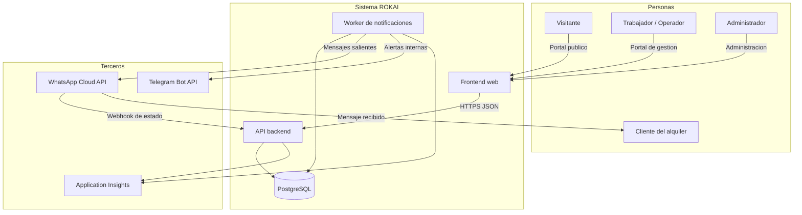
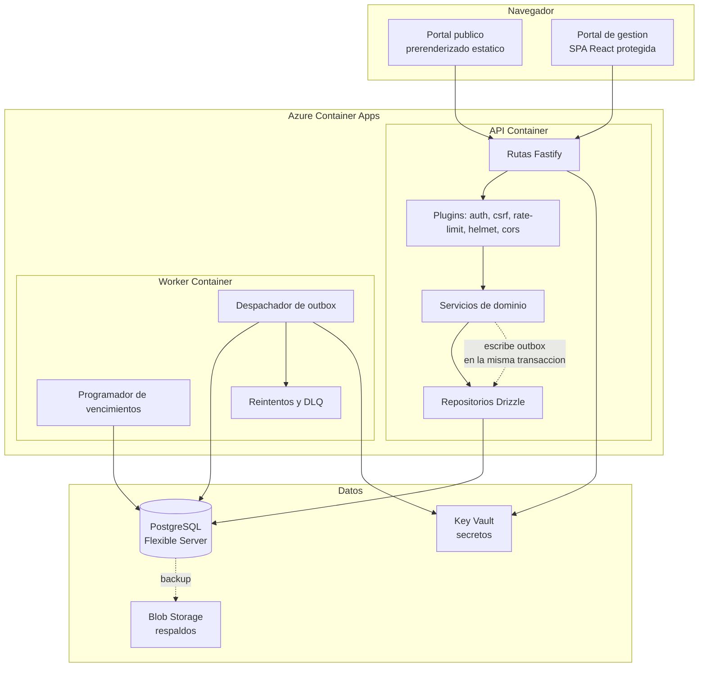
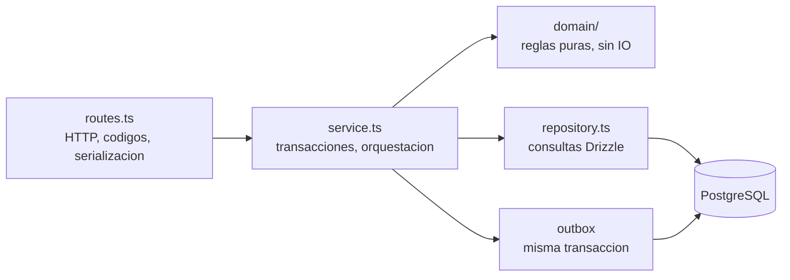
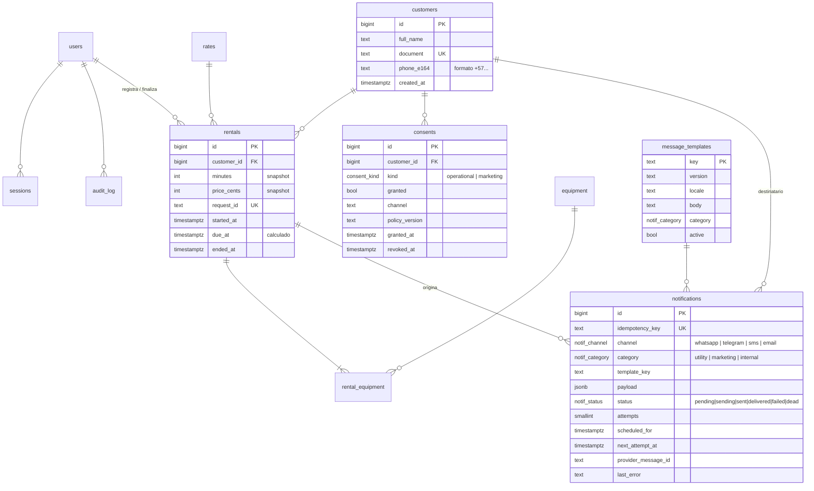
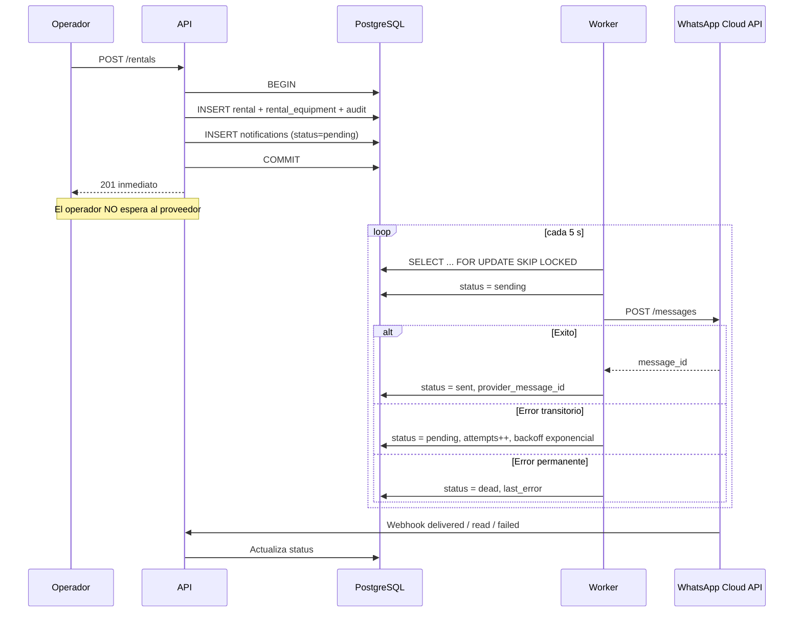
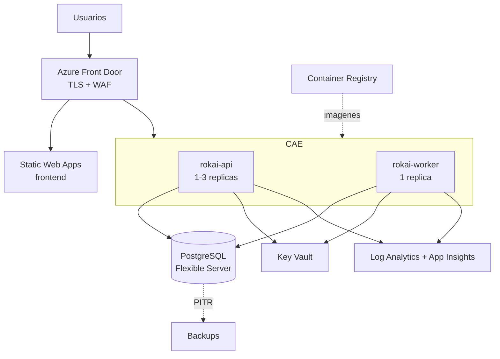

# Arquitectura Objetivo — ROKAI v2

**Fecha:** 2026-10-26
**Estado:** Propuesta para aprobación — _ninguna mejora se implementa hasta que este documento sea aprobado_
**Reemplaza a:** monolito `server.mjs` + SPA `public/app.js` (ver [ARQUITECTURA.md](ARQUITECTURA.md))
**Base funcional:** [PRD.md](PRD.md) · **Base visual:** [DESIGN.md](DESIGN.md)

---

## 1. Propósito y alcance

Evolucionar ROKAI desde un monolito de archivo único con SQLite hacia una arquitectura de cuatro componentes claramente separados:

| Componente        | Decisión                                                             |
| ----------------- | -------------------------------------------------------------------- |
| **Frontend**      | React 19 + TypeScript + Vite                                         |
| **Backend**       | Node.js 22 LTS + TypeScript + Fastify                                |
| **Base de datos** | PostgreSQL 16                                                        |
| **Mensajería**    | Abstracción de proveedor, con WhatsApp Cloud API como canal primario |
| **Despliegue**    | Azure Container Apps + Azure Database for PostgreSQL Flexible Server |

### 1.1 Objetivos

1. Separar frontend y backend en artefactos desplegables independientes.
2. Sustituir SQLite por PostgreSQL con migraciones versionadas e integridad declarada en el esquema.
3. Incorporar notificaciones a clientes y alertas internas con entrega garantizada.
4. Conservar íntegramente las reglas de negocio ya validadas del MVP (precio en servidor, idempotencia, exclusión de equipos, trazabilidad).
5. Resolver la deuda de mantenibilidad: código modular, tipado, revisable y con pruebas ejecutables en Windows y Linux.

### 1.2 Fuera de alcance de esta versión

Autoservicio del cliente, reservas anticipadas, pagos en línea, recargos automáticos, multi-estación y aplicación móvil nativa. El diseño no los impide, pero no se construyen aquí.

**Campañas y promociones comerciales quedan diferidas a una fase 2 posterior.** La mensajería de esta versión es exclusivamente **operativa**: notificaciones del alquiler en curso y alertas internas. Ver [§10.7](#107-fase-2-campañas-y-promociones).

---

## 2. Aviso importante sobre "proveedor gratis" de mensajería

Pediste un proveedor gratuito. Debo ser directo: **no existe un proveedor de SMS gratuito para Colombia en volumen de producción.** El SMS tiene un costo de interconexión real con los operadores (Claro, Movistar, Tigo) que ningún proveedor absorbe. Lo que sí existe:

| Opción                                 | Costo real                                                                                                                                                                                                                                                                                                                 | Veredicto                                                                                                             |
| -------------------------------------- | -------------------------------------------------------------------------------------------------------------------------------------------------------------------------------------------------------------------------------------------------------------------------------------------------------------------------- | --------------------------------------------------------------------------------------------------------------------- |
| **WhatsApp Cloud API (Meta)**          | API sin costo de plataforma. Las _conversaciones de servicio_ (responder dentro de la ventana de 24 h abierta por el cliente) son **gratuitas e ilimitadas**. Las plantillas de _utilidad_ dentro de esa ventana también son gratuitas. Las plantillas de marketing y las enviadas fuera de ventana se cobran por mensaje. | ✅ **Recomendado.** Es el canal que ROKAI **ya usa** (+57 310 681 7317) y el que el cliente colombiano realmente lee. |
| **Telegram Bot API**                   | 100 % gratuito, sin límites prácticos.                                                                                                                                                                                                                                                                                     | ✅ Útil para **alertas internas al administrador**. Inviable para clientes turistas.                                  |
| **Twilio SMS**                         | Crédito de prueba limitado, solo a números verificados. En producción se paga por mensaje.                                                                                                                                                                                                                                 | ⚠️ Solo como respaldo si WhatsApp falla.                                                                              |
| **Azure Communication Services SMS**   | Sin capa gratuita. Además, el envío a Colombia exige registro de remitente.                                                                                                                                                                                                                                                | ⚠️ Solo si se quiere facturación unificada en Azure.                                                                  |
| **Correo electrónico** (Resend, Brevo) | Capas gratuitas reales de 3 000/mes o 300/día.                                                                                                                                                                                                                                                                             | ✅ Complemento gratuito para comprobantes.                                                                            |

### Decisión de diseño

Se diseña una **abstracción `NotificationProvider`** con tres implementaciones desde el día uno:

- `WhatsAppCloudProvider` — canal primario a clientes.
- `ConsoleProvider` — desarrollo y pruebas, costo cero, sin salida a red.
- `TelegramProvider` — alertas internas al administrador, costo cero.

`TwilioSmsProvider` queda definido en la interfaz pero **no se implementa** hasta que exista una decisión de presupuesto. Cambiar de proveedor será una variable de entorno, no una refactorización.

### Marco legal y consentimiento

Las campañas comerciales se difieren a fase 2, lo que **reduce significativamente la carga legal de esta versión**: la mensajería operativa tiene como base legal la ejecución del servicio contratado, no requiere opt-in comercial.

Aun así, el modelo de datos incorpora desde ahora **dos consentimientos independientes**:

- `operational` — notificaciones del alquiler en curso. **Es lo único que se usa en v2.**
- `marketing` — promociones. Columna y enum creados, **sin funcionalidad asociada en v2**.

**Por qué se modela ahora algo que no se usa:** añadir el valor al enum y la fila a `consents` cuesta prácticamente nada hoy y evita una migración sobre datos de producción más adelante. El costo de la previsión es menor que el de la corrección.

El servicio de mensajería **rechaza en código** cualquier envío de categoría `marketing`, sin excepción, mientras la fase 2 no esté habilitada. No se deja a disciplina del operador.

> Cuando se aborde la fase 2: bajo la **Ley 1581 de 2012** y el Decreto 1377 de 2013 (habeas data, vigilado por la SIC), enviar mensajes comerciales exige consentimiento previo, expreso e informado, separado del operativo y con mecanismo de revocación. Las sanciones son materiales.

---

## 3. Decisiones arquitectónicas

| #      | Decisión                                        | Alternativa descartada            | Motivo                                                                                                                             |
| ------ | ----------------------------------------------- | --------------------------------- | ---------------------------------------------------------------------------------------------------------------------------------- |
| ADR-01 | Monorepo con npm workspaces                     | Repos separados                   | Contratos de tipos compartidos entre web y API sin publicar paquetes                                                               |
| ADR-02 | Fastify sobre Express                           | Express, NestJS                   | Más rápido, validación con JSON Schema nativa, ecosistema de plugins de seguridad; NestJS añade peso innecesario para este dominio |
| ADR-03 | Drizzle ORM                                     | Prisma, SQL puro                  | SQL-first y tipado, migraciones versionadas en archivos, sin motor binario adicional en el contenedor                              |
| ADR-04 | Zod como fuente única de contratos              | Tipos duplicados                  | Un esquema genera el tipo TypeScript, la validación en API y la validación en formularios                                          |
| ADR-05 | Sesiones con cookie opaca en servidor           | JWT                               | Permite revocación inmediata — requisito ya cubierto por RN de desactivación de usuario. El JWT no se puede invalidar              |
| ADR-06 | **Patrón Outbox transaccional** para mensajería | Llamada directa al proveedor      | Un fallo de red del proveedor no debe revertir ni bloquear el registro del alquiler, y ningún mensaje debe perderse                |
| ADR-07 | Portal público prerenderizado en build          | SPA pura, SSR                     | El portal público necesita SEO e indexación; el contenido cambia poco. SSR añade un servidor que no se justifica                   |
| ADR-08 | Worker como proceso separado del API            | Cron dentro del API               | El envío de mensajes y el barrido de vencimientos no deben competir por el event loop que atiende a los operadores                 |
| ADR-09 | PostgreSQL con enums nativos y constraints      | Validación solo aplicativa        | La integridad del dominio sobrevive a cualquier bug de la capa de aplicación                                                       |
| ADR-10 | Clientes extraídos a tabla propia               | Datos denormalizados en `rentals` | Necesario para consentimiento, historial del cliente y para no duplicar números de teléfono                                        |

---

## 4. Vista de contexto



---

## 5. Vista de contenedores



### 5.1 Separación de responsabilidades

| Contenedor     | Responsabilidad                                                                                       | Escala                                                              |
| -------------- | ----------------------------------------------------------------------------------------------------- | ------------------------------------------------------------------- |
| **Frontend**   | Renderizado, estado de UI, validación de formularios. **Cero reglas de negocio con valor económico.** | CDN / estático                                                      |
| **API**        | Autenticación, autorización, validación, reglas de negocio, transacciones.                            | 1–3 réplicas                                                        |
| **Worker**     | Despacho de mensajes, reintentos, barrido de vencimientos, limpieza programada.                       | **1 réplica — single writer**, con bloqueo consultivo de PostgreSQL |
| **PostgreSQL** | Única fuente de verdad. Integridad declarada.                                                         | Flexible Server B1ms → escalable                                    |

> **Nota crítica:** el worker usa `SELECT ... FOR UPDATE SKIP LOCKED` sobre la tabla outbox. Esto permite escalar a varias réplicas sin enviar mensajes duplicados si el volumen lo exige más adelante.

---

## 6. Estructura del repositorio

```
rokai/
├── apps/
│   ├── web/                      # React + TypeScript + Vite
│   │   ├── src/
│   │   │   ├── routes/           # Rutas publicas y de gestion
│   │   │   ├── features/         # rentals, fleet, rates, users, faqs, settings, notifications
│   │   │   ├── components/       # Primitivas de UI del design system
│   │   │   ├── lib/              # cliente API, auth, formato es-CO
│   │   │   └── styles/           # tokens derivados de DESIGN.md
│   │   └── vite.config.ts
│   ├── api/                      # Fastify + TypeScript
│   │   └── src/
│   │       ├── plugins/          # auth, csrf, rate-limit, security-headers, error-handler
│   │       ├── modules/          # un modulo por agregado del dominio
│   │       │   └── rentals/      # routes.ts · service.ts · repository.ts · schema.ts
│   │       ├── domain/           # reglas puras, sin IO — testeables unitariamente
│   │       └── server.ts
│   └── worker/                   # Despachador y programador
│       └── src/
│           ├── dispatcher.ts
│           ├── scheduler.ts
│           └── providers/        # whatsapp · telegram · console · (twilio)
├── packages/
│   ├── contracts/                # Esquemas Zod + tipos compartidos web ↔ api
│   ├── db/                       # Esquema Drizzle + migraciones + seeds
│   └── config/                   # tsconfig, eslint, prettier compartidos
├── infra/                        # Bicep
├── docs/
└── docker-compose.yml            # PostgreSQL local + Adminer
```

**Regla de dependencias:** `web` y `api` dependen de `contracts`. `api` y `worker` dependen de `db`. **`contracts` y `db` no dependen de nada del proyecto.** Esto se verifica en CI con una regla de lint, no con buena voluntad.

---

## 7. Frontend

### 7.1 Stack

| Pieza           | Elección                                                     |
| --------------- | ------------------------------------------------------------ |
| Framework       | React 19 + TypeScript (modo `strict`)                        |
| Build           | Vite 6                                                       |
| Enrutado        | React Router 7                                               |
| Estado servidor | TanStack Query — caché, reintentos, revalidación             |
| Estado local    | `useState` / `useReducer`. **Sin Redux**                     |
| Formularios     | React Hook Form + resolver de Zod desde `packages/contracts` |
| Estilos         | CSS Modules + variables CSS generadas desde `DESIGN.md`      |
| Pruebas         | Vitest + Testing Library + Playwright (E2E)                  |

### 7.2 Design system

Los tokens de `DESIGN.md` (paleta _Coastal Kinetic Tech_, tipografía Inter, escalas de titular) se generan a **variables CSS** mediante un script de build que lee el YAML. La paleta deja de estar duplicada entre el documento y el CSS.

```
surface #faf9f5 · on-surface #1b1c1a · primary #0f1113
secondary-container #caf248 (acento lima ROKAI) · error #ba1a1a
```

Las fuentes Inter se siguen sirviendo localmente — se conserva esa decisión del MVP, que permite una CSP sin orígenes externos.

### 7.3 Dos superficies, un proyecto

| Superficie            | Rutas                                       | Entrega                                                                                                                        |
| --------------------- | ------------------------------------------- | ------------------------------------------------------------------------------------------------------------------------------ |
| **Portal público**    | `/`, `/terminos`, `/privacidad`, `/cookies` | **Prerenderizado en build** a HTML estático. Indexable, primer render inmediato, funciona sin JS para el contenido informativo |
| **Portal de gestión** | `/gestion/*`, `/login`                      | SPA con _code splitting_: su bundle **no se descarga** en la visita pública                                                    |

El contenido dinámico del portal público (tarifas vigentes, FAQ, ajustes) se hidrata desde `GET /api/v1/public`, con los valores del build como contenido inicial.

### 7.4 Corrección de la clase de error XSS

El MVP construye HTML con plantillas y `esc()` manual; un solo olvido introduce XSS almacenado. React escapa por defecto. **Se prohíbe `dangerouslySetInnerHTML`** mediante regla de ESLint con error, sin excepciones. Los textos legales largos se renderizan con un componente que convierte saltos de línea a párrafos sin interpretar HTML.

### 7.5 Experiencia operativa que se conserva y mejora

- **Borrador de alquiler:** se mantiene en servidor por usuario, con _debounce_. Se añade respaldo en IndexedDB para tolerar caída de red real **sin datos del cliente en `localStorage`**, respetando la decisión original de privacidad.
- **Idempotencia:** el `request_id` UUID por formulario se conserva tal cual. Es uno de los mejores aciertos del MVP.
- **Indicador sin conexión** y reintento automático al recuperar conectividad.
- **Accesibilidad:** objetivo WCAG 2.2 AA. Navegación por teclado, foco visible, `aria-live` para toasts, verificación automática con `axe` en CI.

---

## 8. Backend

### 8.1 Capas



**Regla estricta:** `routes` nunca toca `repository`. `domain` no importa nada con IO — por eso es testeable con pruebas unitarias rápidas, algo imposible hoy.

### 8.2 Contrato de API

Versionado bajo `/api/v1`. Esquemas Zod convertidos a JSON Schema y expuestos como **OpenAPI 3.1** en `/api/v1/docs` (solo en entornos no productivos).

```
GET    /api/v1/public                     Tarifas, FAQ y ajustes publicos
GET    /api/v1/health                     Liveness
GET    /api/v1/ready                      Readiness, verifica PostgreSQL

POST   /api/v1/auth/login
POST   /api/v1/auth/logout
GET    /api/v1/auth/session

GET    /api/v1/rentals                    Paginado + filtros (estado, fecha, texto)
POST   /api/v1/rentals                    Idempotente por request_id
GET    /api/v1/rentals/:id
POST   /api/v1/rentals/:id/finish

GET    /api/v1/equipment
PATCH  /api/v1/equipment/:id
GET    /api/v1/dashboard/summary          Solo metricas agregadas

GET    /api/v1/customers                  Busqueda por documento o telefono
PATCH  /api/v1/customers/:id/consent

GET    /api/v1/admin/rates                CRUD
GET    /api/v1/admin/users                CRUD
GET    /api/v1/admin/faqs                 CRUD
PUT    /api/v1/admin/settings
GET    /api/v1/admin/audit                Paginado
GET    /api/v1/admin/notifications        Bandeja de salida y estados
POST   /api/v1/admin/notifications/:id/retry

POST   /api/v1/webhooks/whatsapp          Firma HMAC verificada
```

### 8.3 Correcciones explícitas al MVP

| Problema en v1                              | Solución en v2                                                                                                  |
| ------------------------------------------- | --------------------------------------------------------------------------------------------------------------- |
| Path traversal roto en Windows              | **El API no sirve archivos estáticos.** El problema desaparece por diseño; el frontend es un artefacto separado |
| `/api/dashboard` devuelve todo el historial | Paginación por cursor obligatoria; `summary` devuelve solo agregados                                            |
| Consulta N+1 de equipos por alquiler        | Un `JOIN` con `json_agg` en una sola consulta                                                                   |
| Sin índices                                 | Índices declarados en el esquema y verificados por prueba de rendimiento                                        |
| Rate limit por `socket.remoteAddress`       | `@fastify/rate-limit` con `trustProxy` acotado a las IP de Azure Front Door / Container Apps                    |
| CSRF comparado con `!==`                    | `timingSafeEqual`                                                                                               |
| `transaction()` no reentrante               | Transacciones de Drizzle con `SAVEPOINT` anidado                                                                |
| Sin apagado ordenado                        | `SIGTERM` → deja de aceptar conexiones, drena peticiones en curso, cierra el pool                               |
| Logs planos                                 | Pino con JSON estructurado y `requestId` por petición                                                           |

---

## 9. Modelo de datos



### 9.1 Cambios frente al esquema v1

| Cambio                                      | Motivo                                                                                                                                                                                                                                        |
| ------------------------------------------- | --------------------------------------------------------------------------------------------------------------------------------------------------------------------------------------------------------------------------------------------- |
| **Tabla `customers`** extraída de `rentals` | Sin ella no hay consentimiento, ni teléfono normalizado, ni historial de cliente recurrente                                                                                                                                                   |
| **`phone_e164`** normalizado a `+57…`       | Requisito del proveedor de mensajería; hoy el teléfono es texto libre y opcional                                                                                                                                                              |
| **`price_cents` entero**                    | Se elimina toda posibilidad de aritmética de punto flotante sobre dinero                                                                                                                                                                      |
| **`due_at` calculado y persistido**         | El programador necesita un índice sobre el vencimiento, no un cálculo por fila                                                                                                                                                                |
| **Enums nativos de PostgreSQL**             | `role`, `equipment_status`, `equipment_kind`, `rate_period`, `notif_*` dejan de depender del código                                                                                                                                           |
| **`audit_log` con `before`/`after` JSONB**  | Hoy se audita "editar_configuracion/publica" sin saber qué cambió                                                                                                                                                                             |
| **`schema_migrations`** versionadas         | Elimina los parches ad hoc tipo `INSERT OR IGNORE` del arranque                                                                                                                                                                               |
| **Índices declarados**                      | `rentals(ended_at) WHERE ended_at IS NULL`, `rentals(due_at) WHERE ended_at IS NULL`, `rental_equipment(equipment_id)`, `sessions(expires_at)`, `notifications(status, next_attempt_at)`, `customers(document)`, `audit_log(created_at DESC)` |
| **`timestamptz` en todo**                   | El MVP mezcla ISO UTC con fechas de `America/Bogota`. Se almacena en UTC y se presenta en zona Bogotá                                                                                                                                         |

### 9.2 Invariantes que se conservan

Estos son los aciertos del MVP y **se mantienen sin negociación**:

- Precio y duración como _snapshot_ en `rentals`: cambiar una tarifa nunca reescribe la historia.
- `request_id UNIQUE`: idempotencia garantizada por la base de datos.
- Token de sesión hasheado con SHA-256 en reposo.
- Historial sin borrado; la auditoría es _append-only_.
- Exclusión de equipos en una transacción serializada.

### 9.3 Migración de datos

Script `packages/db/migrate-from-sqlite.ts`: lee `data/rokai.sqlite`, normaliza teléfonos a E.164, deriva `customers` a partir de documentos distintos en `rentals`, convierte precios a centavos, calcula `due_at` y **registra consentimiento `operational` únicamente** — ningún cliente histórico se asume suscrito a marketing.

---

## 10. Arquitectura de mensajería

Es el componente nuevo y el que más puede fallar en producción. Se diseña asumiendo que el proveedor externo **estará caído en algún momento**.

### 10.1 Patrón Outbox transaccional



**Garantías que esto produce:**

1. Si el proveedor está caído, **el alquiler se registra igual**. La notificación queda pendiente y se envía al recuperarse.
2. Ningún mensaje se pierde: vive en la misma transacción que el hecho de negocio.
3. Ningún mensaje se duplica: `idempotency_key` único por evento.
4. El operador nunca espera una llamada de red externa.

### 10.2 Interfaz del proveedor

```ts
interface NotificationProvider {
  readonly channel: NotifChannel;
  send(message: OutboundMessage): Promise<SendResult>;
  verifyWebhook(req: WebhookRequest): boolean;
  parseStatus(payload: unknown): DeliveryStatus[];
}
```

Selección por variable de entorno `NOTIFICATIONS_PROVIDER`. En desarrollo y en CI el valor por defecto es `console`: **cero costo, cero salida a red, cero riesgo de enviar un mensaje real a un cliente durante una prueba.**

### 10.3 Catálogo de eventos

| Evento                    | Canal    | Categoría  | Momento                      | Consentimiento |
| ------------------------- | -------- | ---------- | ---------------------------- | -------------- |
| `rental.started`          | WhatsApp | `utility`  | Inmediato                    | `operational`  |
| `rental.due_soon`         | WhatsApp | `utility`  | `due_at - 10 min`            | `operational`  |
| `rental.overdue`          | WhatsApp | `utility`  | `due_at + 5 min`             | `operational`  |
| `rental.finished`         | WhatsApp | `utility`  | Al cerrar                    | `operational`  |
| `equipment.overdue_alert` | Telegram | `internal` | `due_at + 15 min`            | No aplica      |
| `equipment.incident`      | Telegram | `internal` | Al registrar novedad crítica | No aplica      |

Todos los eventos de v2 son de **utilidad o internos**. Ninguno es comercial, por lo que todos caen dentro de la ventana gratuita de WhatsApp cuando el cliente ha interactuado, y ninguno requiere opt-in de marketing.

### 10.4 Programador de vencimientos

El worker ejecuta cada minuto, bajo `pg_advisory_lock` para garantizar un único ejecutor:

```sql
SELECT id FROM rentals
WHERE ended_at IS NULL
  AND due_at BETWEEN now() AND now() + interval '10 minutes'
  AND NOT EXISTS (
    SELECT 1 FROM notifications n
    WHERE n.rental_id = rentals.id AND n.template_key = 'rental.due_soon'
  );
```

El `NOT EXISTS` evita el envío repetido en cada ciclo. El índice parcial sobre `(due_at) WHERE ended_at IS NULL` hace la consulta trivial.

### 10.5 Política de reintentos

| Intento | Espera                              |
| ------- | ----------------------------------- |
| 1 → 2   | 30 s                                |
| 2 → 3   | 2 min                               |
| 3 → 4   | 10 min                              |
| 4 → 5   | 1 h                                 |
| 5       | → `dead`, alerta interna a Telegram |

Los mensajes `dead` son visibles y reenviables desde Administración → Notificaciones. **Nada falla en silencio.**

### 10.6 Salvaguardas de costo y abuso

- Tope diario configurable de mensajes; superado, se detiene el despacho y se alerta.
- La categoría `marketing` está **deshabilitada por completo** mediante bandera de funcionalidad; el despachador la descarta antes de llamar al proveedor.
- En entornos no productivos, lista blanca de números destino.
- Las plantillas de WhatsApp se almacenan versionadas en `message_templates`; cambiar un texto no requiere desplegar.

### 10.7 Fase 2 — Campañas y promociones

Diferido por decisión explícita. Cuando se retome, lo que ya quedará resuelto por el diseño de v2:

- Tabla `consents` con la categoría `marketing` y su historial de otorgamiento y revocación.
- `message_templates` versionadas, con categoría por plantilla.
- Outbox con reintentos, estados de entrega y bandeja administrativa.
- Contactos normalizados en `customers` con teléfono E.164.

Lo que habrá que construir entonces: captura del opt-in en el registro del alquiler, envío por lotes con aprobación del administrador, segmentación, mecanismo de baja (`opt-out`) en cada mensaje, y el control de costo asociado al mensaje comercial, que **sí se cobra** en WhatsApp.

**Requisito previo:** política de privacidad aprobada y texto de consentimiento revisado legalmente.

---

## 11. Seguridad

### 11.1 Se conserva del MVP

Hash scrypt con salt, `timingSafeEqual`, hash de token de sesión en reposo, cookie `HttpOnly; SameSite=Strict; Secure`, CSRF con doble verificación, validación de `Origin`, CSP sin `unsafe-inline`, límite de intentos de login, revocación de sesiones al desactivar usuario, statements parametrizados.

### 11.2 Se añade

| Control            | Implementación                                                                                                               |
| ------------------ | ---------------------------------------------------------------------------------------------------------------------------- |
| Hash de contraseña | Migración a **Argon2id**, parámetros OWASP 2024. Rehash transparente en el siguiente login exitoso                           |
| Secretos           | Azure Key Vault + Managed Identity. **Ninguna credencial en variables de entorno del contenedor**                            |
| Cabeceras          | `Strict-Transport-Security`, `Permissions-Policy`, además de las ya presentes                                                |
| Rate limit         | Por IP real validada, por usuario y por endpoint; más estricto en `/auth/login`                                              |
| Webhooks           | Verificación de firma HMAC del proveedor antes de procesar cualquier payload                                                 |
| Datos personales   | `customers.document` y `phone_e164` cifrados en reposo a nivel de columna; los logs **nunca** incluyen documento ni teléfono |
| Dependencias       | `npm audit` y Dependabot en CI; bloqueo del merge ante vulnerabilidad alta                                                   |
| Retención          | Purga automática de datos de cliente según plazo definido en la política de privacidad                                       |

### 11.3 Deuda legal heredada

Los documentos de términos, privacidad y cookies siguen siendo **marcadores de posición**. Con la incorporación de mensajería, la política de privacidad pasa a ser **bloqueante**: debe declarar responsable del tratamiento, finalidad de las notificaciones, canal de revocación y plazo de conservación antes de enviar un solo mensaje a un cliente real.

---

## 12. Observabilidad y operación

| Aspecto   | Implementación                                                                                                  |
| --------- | --------------------------------------------------------------------------------------------------------------- |
| Logs      | Pino JSON → Azure Log Analytics, con `requestId` correlacionado                                                 |
| Métricas  | OpenTelemetry → Application Insights                                                                            |
| Trazas    | Propagación HTTP → servicio → base de datos                                                                     |
| Salud     | `/health` (liveness) y `/ready` (verifica PostgreSQL)                                                           |
| Alertas   | Tasa de error 5xx, latencia p95, profundidad de la cola outbox, mensajes `dead`, conexiones de BD               |
| Respaldos | Backup automático de Flexible Server, retención 7 días, PITR; **prueba de restauración trimestral documentada** |

**Indicadores de negocio en el panel:** alquileres activos, equipos disponibles, alquileres vencidos sin devolver, tasa de entrega de notificaciones, costo acumulado de mensajería del mes.

---

## 13. Despliegue en Azure



| Recurso                         | SKU inicial                    | Nota                                                                              |
| ------------------------------- | ------------------------------ | --------------------------------------------------------------------------------- |
| Container Apps                  | Consumo, mín. 1 réplica el API | Escala a cero no recomendada: el arranque en frío castiga al operador en estación |
| PostgreSQL Flexible Server      | B1ms, 32 GB                    | Suficiente para una estación; escalable sin migración                             |
| Static Web Apps                 | Free → Standard                |                                                                                   |
| Key Vault / ACR / Log Analytics | Estándar / Básico              |                                                                                   |

**IaC:** Bicep en `infra/`, con _managed identity_ y sin secretos en el repositorio.

**CI/CD (GitHub Actions):**
`lint → typecheck → pruebas unitarias → pruebas de integración con PostgreSQL en servicio → build → Playwright E2E → imagen a ACR → migraciones → despliegue → verificación de salud`

Las migraciones se ejecutan como paso propio **antes** del despliegue, y deben ser compatibles hacia atrás para permitir reversión.

---

## 14. Requisitos no funcionales

| Atributo                 | Objetivo                                                             |
| ------------------------ | -------------------------------------------------------------------- |
| Latencia API p95         | < 200 ms en operaciones de lectura                                   |
| Registro de alquiler     | < 500 ms extremo a extremo                                           |
| Entrega de notificación  | < 30 s desde el evento, con proveedor disponible                     |
| Disponibilidad           | 99,5 % en horario de operación, 8:00 a. m. – 10:00 p. m.             |
| Carga del portal público | LCP < 2,0 s en 4G                                                    |
| Cobertura de pruebas     | ≥ 80 % en `domain/` y servicios; 100 % de los invariantes de negocio |
| Accesibilidad            | WCAG 2.2 AA                                                          |
| RPO / RTO                | 15 min / 1 h                                                         |

---

## 15. Plan de migración por fases

Cada fase deja el sistema **funcional y desplegable**. No hay un "gran salto".

| Fase                          | Contenido                                                                           | Resultado verificable                                                                   |
| ----------------------------- | ----------------------------------------------------------------------------------- | --------------------------------------------------------------------------------------- |
| **F0 — Fundación**            | Monorepo, `contracts`, `db`, Docker Compose con PostgreSQL, CI con lint + typecheck | `npm test` ejecuta en Windows y Linux                                                   |
| **F1 — Datos**                | Esquema Drizzle completo, migraciones, script de importación desde SQLite           | Los datos actuales viven en PostgreSQL y se verifican por conteo                        |
| **F2 — Backend**              | API Fastify con paridad funcional total frente a `server.mjs`                       | **Las 10 pruebas actuales se portan y pasan**, más las nuevas de paginación y traversal |
| **F3 — Frontend**             | React + Vite, portal público prerenderizado, portal de gestión                      | Paridad visual con el MVP, verificada con Playwright                                    |
| **F4 — Corte**                | Despliegue en Azure, DNS, retiro de `server.mjs`                                    | Producción sobre v2                                                                     |
| **F5 — Mensajería operativa** | Outbox, worker, WhatsApp, alertas internas, bandeja de notificaciones               | Notificaciones operativas en producción. **Cierra el alcance de v2**                    |

### Fase 2 — posterior, fuera de este documento

| Fase              | Contenido                                   | Prerrequisito                                                         |
| ----------------- | ------------------------------------------- | --------------------------------------------------------------------- |
| **F6 — Campañas** | Promociones, segmentación, opt-in y opt-out | Política de privacidad aprobada y presupuesto de mensajería comercial |

No se construye nada de F6 durante v2. La única huella que deja en el diseño es el enum `marketing` en `consents` y `notifications`, sin código que lo utilice.

---

## 16. Riesgos

| Riesgo                                               | Impacto           | Mitigación                                                                                                                                                       |
| ---------------------------------------------------- | ----------------- | ---------------------------------------------------------------------------------------------------------------------------------------------------------------- |
| Aprobación de WhatsApp Business demora semanas       | Retrasa F5        | Iniciar verificación de Meta Business en paralelo desde F0. `ConsoleProvider` permite desarrollar sin cuenta                                                     |
| Costo de mensajería mayor al previsto                | Económico         | **Mitigado al diferir campañas:** v2 solo envía plantillas de utilidad, en su mayoría dentro de la ventana gratuita. Tope diario y métricas de costo en el panel |
| Sanción SIC por mensajería comercial                 | Legal y económico | **Mitigado al diferir campañas:** v2 no envía mensajes comerciales. La categoría `marketing` está bloqueada en código                                            |
| Pérdida de reglas de negocio en la reescritura       | Funcional         | F2 exige portar las 10 pruebas existentes antes de añadir nada nuevo                                                                                             |
| Sobrecosto de Azure sobre un MVP de una estación     | Económico         | SKU básicos, revisión de costo al cierre de F4, alerta de presupuesto                                                                                            |
| Complejidad superior a la necesidad real del negocio | Operativo         | Worker y outbox son la única complejidad añadida; ambos se justifican por la garantía de entrega                                                                 |
| Número de teléfono del cliente hoy es opcional       | Funcional         | F5 exige definir si el teléfono pasa a obligatorio. **Decisión de negocio pendiente**                                                                            |

---

## 17. Decisiones de negocio pendientes

Estas no son técnicas y **bloquean fases concretas**:

1. **¿El teléfono del cliente pasa a ser obligatorio?** Sin él no hay notificaciones. _(Bloquea F5)_
2. **¿Quién es el responsable del tratamiento de datos?** Nombre, canal de contacto y plazo de conservación. _(Bloquea F5)_
3. **Texto aprobado de términos, privacidad y cookies.** _(Bloquea F4 para operar con clientes reales)_
4. **Calendario de festivos colombianos** para la tarifa de fin de semana. Hoy el período se elige a mano. _(Mejora de F2)_
5. **Regla de recargo por tiempo adicional.** Hoy `final_price = price` siempre, por decisión documentada. _(Pendiente de PRD)_

Diferido junto con las campañas: presupuesto de mensajería comercial y texto de consentimiento de marketing. _(Prerrequisitos de F6)_

---

## 18. Conclusión

La arquitectura propuesta conserva todo lo que el MVP hizo bien —snapshots de precio, idempotencia por `request_id`, exclusión transaccional de equipos, sesiones revocables, trazabilidad inmutable— y resuelve sus tres límites reales: portabilidad, mantenibilidad y ausencia de un canal de comunicación con el cliente.

La única complejidad estructural nueva es el **worker con patrón outbox**. Se justifica por una razón concreta: sin él, un fallo de WhatsApp haría fallar el registro de un alquiler, y el operador en la estación no puede depender de la disponibilidad de un tercero para atender a un cliente que tiene enfrente.

Sobre la petición de un proveedor gratuito: **la vía realista es WhatsApp Cloud API**, que elimina el costo de plataforma, es gratuita para conversaciones de servicio y plantillas de utilidad dentro de la ventana de 24 horas, y además es el canal que ROKAI ya usa con sus clientes. El SMS verdaderamente gratuito no existe en Colombia; cualquier propuesta en ese sentido sería inexacta.

Diferir las campañas a fase 2 refuerza esa decisión: **toda la mensajería de v2 es de utilidad o interna**, es decir, la que cae dentro de la ventana gratuita. El costo operativo esperado queda cerca de cero, y la exposición legal se reduce a la que ya existe hoy por tratar datos de clientes.

---

**Siguiente paso:** revisar y aprobar este documento. Tras la aprobación se inicia **F0 — Fundación**. No se modifica código del MVP hasta entonces.
