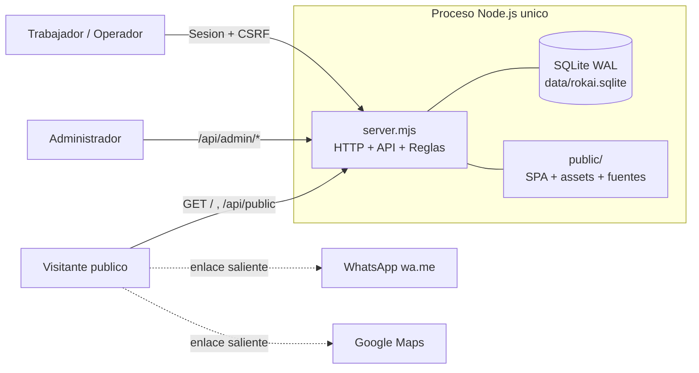
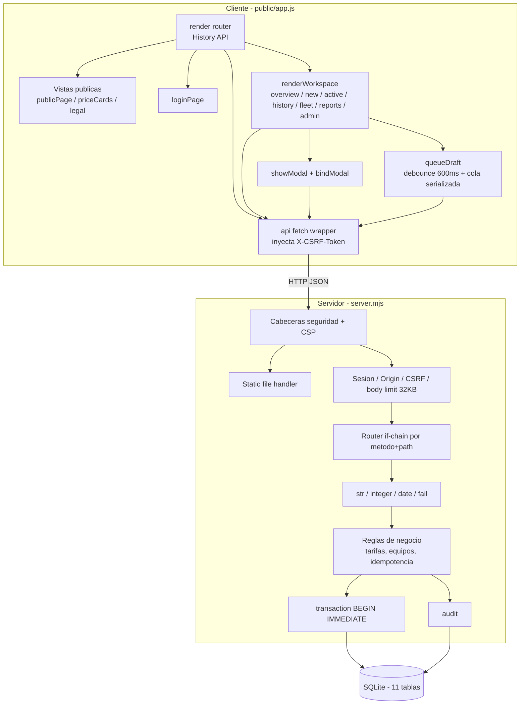
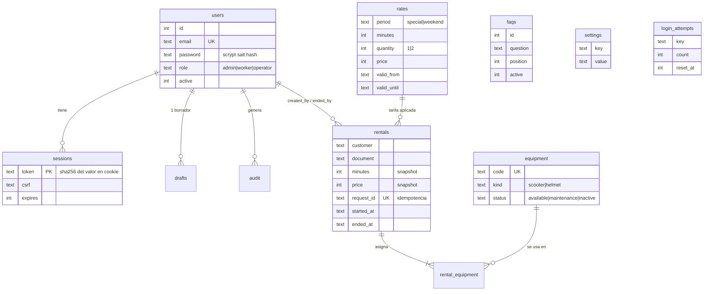
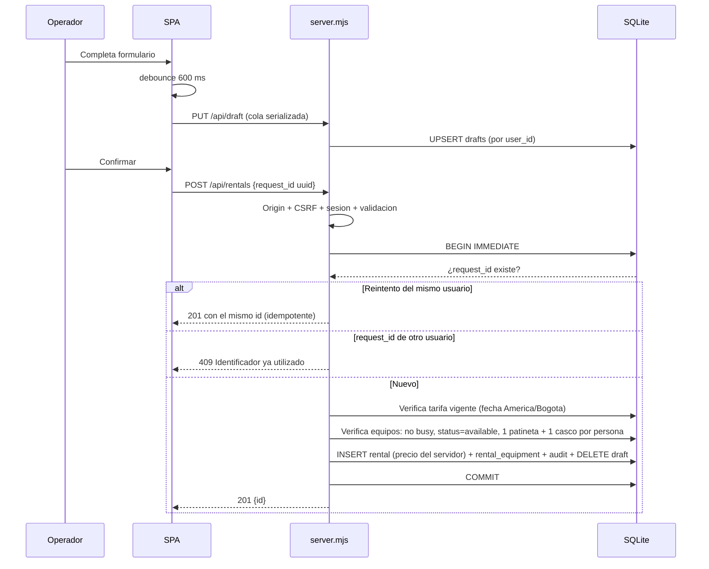

# Reporte de Arquitectura — ROKAI

**Fecha:** 2026-10-26
**Versión analizada:** `package.json` 1.0.0
**Alcance:** revisión estática de `server.mjs`, `public/`, `tests/`, `docs/` y verificación de ejecución en Windows.

---

## 1. Resumen ejecutivo

ROKAI es un **monolito modular mínimo**: un único proceso Node.js sin dependencias externas que combina servidor de archivos estáticos, API JSON y persistencia SQLite embebida, sirviendo una SPA _vanilla_ de un solo archivo JavaScript.

La arquitectura es coherente con el objetivo de un MVP local: cero supply chain, arranque inmediato, superficie de ataque pequeña y controles de seguridad bien elegidos (scrypt, cookies HttpOnly, CSRF, CSP estricta, validación en servidor, transacciones `BEGIN IMMEDIATE`). El modelo de dominio refleja fielmente el PRD y las reglas de negocio críticas (precio, disponibilidad, idempotencia) están correctamente del lado del servidor.

Los riesgos principales no están en el diseño sino en **portabilidad, mantenibilidad y preparación para producción**:

| Severidad  | Hallazgo                                                                                                         |
| ---------- | ---------------------------------------------------------------------------------------------------------------- |
| 🔴 Crítico | La validación anti-path-traversal usa separador `/` fijo; **en Windows ningún archivo estático se sirve (404)**. |
| 🔴 Crítico | El entorno actual tiene Node v20; el proyecto requiere **Node ≥ 24** (`node:sqlite`). La app no arranca.         |
| 🟠 Alto    | `npm test` no resuelve el glob `tests/*.test.mjs` en Windows: **0 pruebas ejecutadas**.                          |
| 🟠 Alto    | Densidad extrema de código (144 líneas con toda la API) — mantenibilidad y revisión muy comprometidas.           |
| 🟠 Alto    | `/api/dashboard` devuelve el historial completo con consulta N+1; no escala.                                     |
| 🟡 Medio   | Rate limiting por `socket.remoteAddress`: tras un proxy, todos los usuarios comparten contador.                  |
| 🟡 Medio   | Sin índices secundarios, sin paginación, sin limpieza programada de sesiones/intentos.                           |
| 🟡 Medio   | Instancia única con SQLite: sin escalado horizontal, sin backups, sin health check ni logging estructurado.      |

---

## 2. Vista de contexto



**Observación:** no hay dependencias de red en tiempo de ejecución. Fuentes, logo e imágenes se sirven localmente, lo que permite una CSP `default-src 'self'` sin excepciones. Es una decisión acertada y poco común.

---

## 3. Vista de componentes



### 3.1 Capas efectivas

| Capa         | Ubicación                            | Estado                                                       |
| ------------ | ------------------------------------ | ------------------------------------------------------------ |
| Presentación | `public/app.js`, `public/styles.css` | SPA sin framework, render por `innerHTML` con `esc()` manual |
| Routing HTTP | `server.mjs` líneas 58–143           | Cadena `if` secuencial, sin tabla de rutas                   |
| Middleware   | Inline en el handler                 | Seguridad, sesión, CSRF, parsing — no extraíbles             |
| Validación   | `str` / `integer` / `date` / `fail`  | Consistente, mensajes en español, orientada a usuario        |
| Dominio      | Mezclado con routing                 | **No existe capa de dominio separada**                       |
| Persistencia | Helpers `all` / `get` / `run`        | Statements preparados por llamada, sin caché ni repositorio  |

**Diagnóstico:** el acoplamiento routing↔dominio↔persistencia es total. Para un MVP de una persona es aceptable; para evolucionar (reservas, pagos, recargos) es el primer bloqueante.

---

## 4. Modelo de datos



### Aciertos del modelo

- **Snapshot de precio y duración** en `rentals`: cambiar una tarifa no reescribe la historia. Validado por pruebas.
- **`request_id UNIQUE`**: idempotencia real a nivel de base de datos, no sólo aplicativa.
- **Token de sesión hasheado** (`sha256`) en reposo: el volcado de la base no permite secuestrar sesiones.
- **Historial sin borrado** y tabla `audit` separada: trazabilidad alineada al PRD.
- `rental_equipment` con PK compuesta evita duplicar un equipo en el mismo alquiler.

### Debilidades del modelo

- **Sin índices secundarios.** Faltan al menos: `rentals(ended_at)`, `rental_equipment(equipment_id)`, `sessions(expires)`, `audit(user_id)`. Hoy cada consulta de disponibilidad hace _full scan_.
- **Sin `NOT NULL` ni `CHECK`** en campos de enumeración (`role`, `status`, `kind`, `period`). La integridad depende del código aplicativo.
- **`settings` sin tipado ni versionado**: textos legales de hasta 10 000 caracteres sin historial de cambios (el `audit` sólo registra "editar_configuracion / publica", sin diff).
- **`drafts.content`** guarda `rate_id`, `equipment_ids` y `request_id` sin validar su forma, sólo limitado por el tope de 32 KB del cuerpo.
- `login_attempts` nunca se purga salvo en login exitoso del mismo `key`; crecimiento no acotado.

---

## 5. Flujo crítico: registrar alquiler



**Fortalezas:** el precio nunca se acepta del cliente (verificado en la prueba que envía `price:1`); el bloqueo `BEGIN IMMEDIATE` serializa la asignación de equipos evitando doble reserva; el borrador se elimina en la misma transacción.

**Riesgo residual:** `transaction()` no es reentrante (`BEGIN` anidado lanzaría error). Hoy no hay anidamiento, pero es una trampa latente sin `SAVEPOINT`.

---

## 6. Seguridad

### 6.1 Controles implementados correctamente

| Control                 | Implementación                                                                                           |
| ----------------------- | -------------------------------------------------------------------------------------------------------- |
| Contraseñas             | `scryptSync` con salt aleatorio de 16 bytes, comparación `timingSafeEqual`                               |
| Enumeración de usuarios | `dummyHash` para igualar el tiempo cuando el correo no existe                                            |
| Sesión                  | Token de 32 bytes, cookie `HttpOnly; SameSite=Strict; Path=/`, `Secure` condicional, 8 h, hash en BD     |
| CSRF                    | Token por sesión en cabecera `X-CSRF-Token` + verificación estricta de `Origin`                          |
| Fuerza bruta            | 8 intentos por IP+correo y 40 por IP, ventana de 15 min                                                  |
| Autorización            | Verificación de sesión antes del router privado; `role==='admin'` para `/api/admin/*`                    |
| Inyección SQL           | Statements preparados en el 100 % de las consultas                                                       |
| Cabeceras               | CSP sin `unsafe-inline`, `nosniff`, `X-Frame-Options: DENY`, `frame-ancestors 'none'`, `base-uri 'none'` |
| DoS básico              | Cuerpo limitado a 32 KB, `Content-Type` obligatorio                                                      |
| Revocación              | Desactivar usuario borra sus sesiones; logout borra sesión y borrador                                    |

Este conjunto es notablemente sólido para un MVP y está **respaldado por pruebas de integración** (origen, CSRF, roles, revocación, aislamiento de borradores, no exposición de `server.mjs` ni del `.sqlite`).

### 6.2 Hallazgos

**🔴 C-1 — Validación de ruta dependiente del separador POSIX**

```js
const target = resolve(ROOT,'public',filename);
if (!target.startsWith(resolve(ROOT,'public') + '/') || !existsSync(target)) fail(404, ...);
```

En Windows `resolve()` produce `C:\MEDEV\rokai\public\app.js`, mientras el prefijo esperado es `C:\MEDEV\rokai\public/`. **Verificado: la comparación devuelve `false`.** Consecuencia: `/app.js`, `/styles.css` y todos los assets responden 404 y la aplicación queda en blanco en Windows. La lógica de seguridad es correcta; el defecto es de portabilidad. Usar `path.sep` o comparar con `relative()`.

**🟡 S-1 — Rate limiting detrás de proxy**
`req.socket.remoteAddress` será la IP del proxy inverso en producción. El límite de 40 intentos/15 min pasaría a ser global: un atacante podría provocar una denegación de servicio sobre el login de todo el personal. Requiere lectura controlada de `X-Forwarded-For` con lista de proxies de confianza.

**🟡 S-2 — Comparación de CSRF no constante en tiempo**
`req.headers['x-csrf-token'] !== session.csrf` permite teóricamente un ataque de temporización. Riesgo bajo (token de 256 bits, ruido de red), pero `timingSafeEqual` ya está importado.

**🟡 S-3 — XSS dependiente de disciplina manual**
El cliente construye HTML con plantillas y `esc()` aplicado a mano en cada interpolación. Un único olvido en contenido editable por el administrador (FAQ, textos legales, ubicación) introduce XSS almacenado. La CSP mitiga scripts externos, pero no `` con `img-src 'self' data:` ni la inyección de markup.

**🟡 S-4 — Sin `Strict-Transport-Security` ni `Permissions-Policy`**
Pendientes para el despliegue HTTPS descrito en el README.

**🟢 S-5 — Endpoint público sin límite**
`/api/public` es anónimo y sin caché (`no-store`); consulta tres tablas por petición. Conviene `Cache-Control` corto o ETag.

---

## 7. Calidad, pruebas y operación

### 7.1 Estado actual

- **10 pruebas de integración** (`tests/api.test.mjs`) con base temporal aislada y puerto efímero. Cubren exactamente los invariantes de mayor riesgo: autorización, CSRF, concurrencia, idempotencia, inmutabilidad de precio, vigencia de tarifas, revocación y persistencia. **La selección de casos es excelente.**
- **Cobertura ausente:** no hay pruebas unitarias de validadores, ni pruebas de frontend, ni de accesibilidad, ni de la ruta de archivos estáticos (precisamente el componente con el fallo crítico C-1).
- **Sin linter, sin formateador, sin CI, sin `package-lock.json`.**

### 7.2 Hallazgos de ejecución verificados

| Problema                    | Detalle                                                                                                                                                                                      |
| --------------------------- | -------------------------------------------------------------------------------------------------------------------------------------------------------------------------------------------- |
| 🔴 Node incompatible        | `engines` exige `>=24`; el entorno tiene **v20.19.5**. `node:sqlite` no existe en v20 → la app no arranca.                                                                                   |
| 🟠 `npm test` inoperante    | `node --test tests/*.test.mjs`: PowerShell no expande globs y Node < 21 no los resuelve. Resultado: **0 pruebas ejecutadas**, sin error visible de configuración. Usar `node --test tests/`. |
| 🟠 README específico de zsh | Las instrucciones de `create-user` usan `read -s` de zsh; no aplican en Windows.                                                                                                             |

### 7.3 Brechas de operación

- Sin endpoint de salud (`/healthz`), sin métricas, sin logging estructurado (`console.error` plano, sin correlación de petición).
- Sin apagado ordenado: no se cierra la conexión SQLite ni se drena el servidor ante `SIGTERM`.
- Sin estrategia de backup ni de migraciones: el esquema se crea con `CREATE TABLE IF NOT EXISTS` y los cambios futuros no tienen versionado (el parche de `instagram`/`email` ya se resolvió con un `INSERT OR IGNORE` ad hoc — señal temprana de esta deuda).
- Sin Dockerfile ni IaC; el despliegue descrito en el README es manual.

---

## 8. Rendimiento y escalabilidad

| Hallazgo                                                                                          | Impacto                                                                                            |
| ------------------------------------------------------------------------------------------------- | -------------------------------------------------------------------------------------------------- |
| **Consulta N+1** en `rentals()`: una consulta de equipos por cada alquiler                        | Con 5 000 alquileres históricos, cada carga del panel ejecuta 5 001 consultas                      |
| **Sin paginación**: `/api/dashboard` devuelve todo el historial a todos los roles                 | Payload de crecimiento lineal e ilimitado                                                          |
| **Sin índices** sobre las columnas de filtrado                                                    | Escaneos completos en disponibilidad e historial                                                   |
| **Statements no cacheados**: `db.prepare()` en cada llamada                                       | Coste constante evitable                                                                           |
| **`activeRates()` y `equipment()` invocados varias veces** dentro de la misma transacción de alta | Trabajo duplicado por petición                                                                     |
| **SQLite síncrono en el hilo principal**                                                          | Cualquier consulta lenta bloquea todo el proceso                                                   |
| **Instancia única, estado local**                                                                 | Sin escalado horizontal; el reinicio corta todas las sesiones activas sólo si se pierde el volumen |

Para el volumen esperado (una estación, 4 patinetas) ninguno es urgente. Todos lo serán si se añaden estaciones o se acumula un año de historial.

---

## 9. Mantenibilidad

El código está escrito en un estilo deliberadamente comprimido: 144 líneas físicas contienen el servidor completo, con líneas individuales de más de 1 000 caracteres que encadenan validación, transacción, auditoría y respuesta. `public/app.js` sigue el mismo patrón en 69 líneas y 42 KB.

Consecuencias medibles:

- Los `diff` de Git son ilegibles: cualquier cambio reescribe una línea entera.
- Los _stack traces_ apuntan siempre a la misma línea, sin utilidad diagnóstica.
- La revisión por pares y el análisis estático son impracticables.
- El onboarding de un segundo desarrollador tiene un coste desproporcionado.

No es un problema de corrección —el código es competente y las decisiones son buenas— sino de **sostenibilidad del activo**.

---

## 10. Cumplimiento del PRD

| Requisito del PRD                                           | Estado                                              |
| ----------------------------------------------------------- | --------------------------------------------------- |
| Portal público con tarifas, FAQ, legales, cookies, contacto | ✅ Completo                                         |
| Cliente final sin capacidad de alquilar/modificar           | ✅ Garantizado en servidor                          |
| Registro por trabajador/operador identificado               | ✅ `created_by` / `ended_by`                        |
| Selección de patineta, tarifa, duración, hora de inicio     | ✅ Con exclusión transaccional                      |
| Alquileres activos y finalización con hora y valor final    | ✅                                                  |
| Novedades de servicio y equipo                              | ✅ Concatenadas en `notes`                          |
| Configuración, tarifas, usuarios y reportes sólo admin      | ✅ Verificado por pruebas                           |
| Trazabilidad                                                | ✅ Tabla `audit`, 300 últimas operaciones           |
| Documentos legales definitivos                              | ⚠️ Marcadores de posición declarados explícitamente |
| Reservas, pagos en línea, recargos, depósitos               | ⛔ Fuera de alcance por decisión documentada        |

La implementación es fiel al PRD y las omisiones están declaradas con honestidad en el README, incluidas las pendientes de negocio (festivos, datos obligatorios del cliente, códigos físicos del inventario).

---

## 11. Recomendaciones priorizadas

### Bloqueantes (antes de cualquier demostración)

1. **Corregir C-1**: sustituir la comparación por separador fijo por `path.sep` o `relative()`; añadir una prueba de regresión que pida `/styles.css` y un intento de _traversal_ (`/../server.mjs`).
2. **Alinear el entorno a Node ≥ 24** o documentar la instalación; sin ello la app no ejecuta.
3. **Arreglar el script de pruebas** a `node --test tests/` para que la suite realmente corra en todas las plataformas.

### Alto (antes de producción)

4. Confianza de proxy explícita para el rate limiting (S-1) y `timingSafeEqual` para el CSRF (S-2).
5. `Strict-Transport-Security` y `Permissions-Policy` junto con `COOKIE_SECURE=1`.
6. Health check, apagado ordenado y logging estructurado con identificador de petición.
7. Backup programado del archivo SQLite y un esquema de migraciones versionado.

### Medio (sostenibilidad)

8. Dividir `server.mjs` en módulos: `db.mjs`, `security.mjs`, `validate.mjs`, `routes/*.mjs`; y `app.js` en vistas. Formatear a una sentencia por línea. Es la inversión de mayor retorno del proyecto.
9. Índices secundarios, eliminación del N+1 (una sola consulta de equipos con `IN`) y paginación del historial.
10. Reemplazar el escapado manual por una función `html` de plantillas etiquetadas que escape por defecto, eliminando la clase de error S-3.
11. Limpieza periódica de `sessions` y `login_attempts`.
12. `package-lock.json`, linter y CI mínima que ejecute la suite en Windows y Linux.

---

## 12. Conclusión

La arquitectura es **apropiada y bien razonada para su propósito**: un MVP verificable, sin dependencias, con las reglas de negocio y los controles de seguridad correctamente situados en el servidor y respaldados por pruebas que atacan los invariantes correctos. El diseño del modelo de datos —snapshots de precio, idempotencia por `request_id`, tokens hasheados, historial inmutable— demuestra criterio de ingeniería por encima del promedio para un proyecto de este tamaño.

Las acciones inmediatas son de **portabilidad y entorno**, no de rediseño: la aplicación actualmente no funciona en Windows por un detalle de un carácter, y su suite de pruebas no se está ejecutando. Resueltos esos puntos, la deuda dominante es la **densidad del código**, que condiciona cualquier evolución futura más que cualquier decisión estructural tomada hasta ahora.
